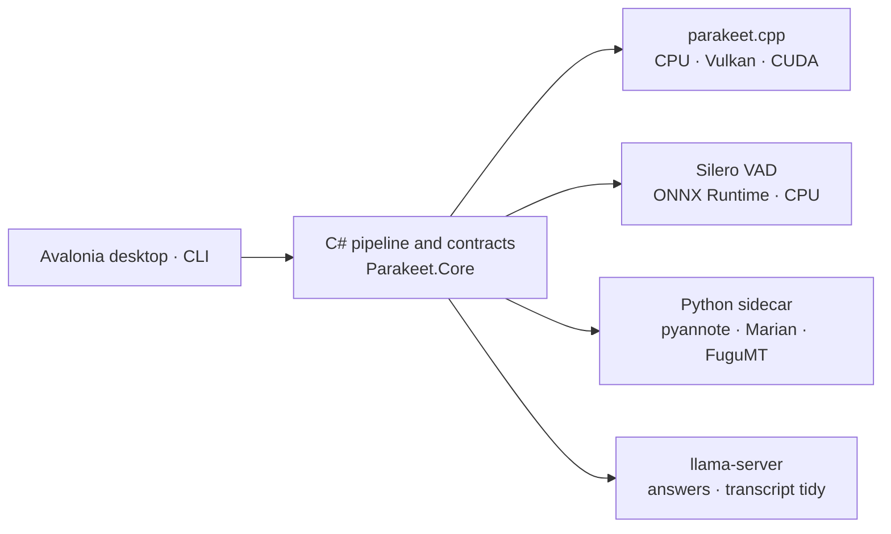

<p align="center">
  
</p>

<h1 align="center">Uindosill</h1>

<p align="center">
  <strong>Turn recordings into transcripts you can search, translate and question.</strong><br>
  A Windows desktop app and CLI that run speech recognition and language models on your PC.
</p>

<p align="center">C# / .NET 10 &nbsp;·&nbsp; Avalonia &nbsp;·&nbsp; Native interop &nbsp;·&nbsp; Python sidecar</p>

<p align="center">
  <a href="https://github.com/jkkma/uindosill/releases/latest"><strong>Download</strong></a>
  &nbsp;·&nbsp; <a href="#build-and-try-the-pipeline">Try the pipeline</a>
  &nbsp;·&nbsp; <a href="docs/ARCHITECTURE.md">Architecture</a>
  &nbsp;·&nbsp; <a href="#documentation">Documentation</a>
</p>

<p align="center">
  <a href="https://github.com/jkkma/uindosill/actions/workflows/ci.yml"></a>
  <a href="https://github.com/jkkma/uindosill/releases/latest"></a>
</p>

## From a recording to something useful

Drop in audio or video, or paste a link. Follow the transcript alongside playback, export subtitles,
or ask a question and jump back to the passage behind the answer.

| Capability | What you get |
|---|---|
| **Transcription** | Timestamped speech recognition through [parakeet.cpp](https://github.com/mudler/parakeet.cpp), on CPU, Vulkan or CUDA. The default model covers 25 European languages; Japanese is a separate, optional model. |
| **Playback and search** | Clickable transcript cues, the current line highlighted during playback, a find box, and video through libmpv. Links queue the audio for transcription and stream the picture on the Ask tab. |
| **Speaker labels and translation** | Optional pyannote speaker labels and Marian / FuguMT English translations, displayed beside the original transcript with its timing preserved. |
| **Questions with citations** | A local llama-server answers questions and summarises the recording. Citations resolve transcript segment IDs to times in application code; unresolved references stay visibly unresolved. |
| **A separate tidied copy** | Optional removal of fillers and false starts. A checked edit contract rejects unsupported rewrites and excessive deletions, while preserving the original transcript. |
| **Useful exports** | Plain text, Markdown, SRT, VTT, word-timed VTT, timestamped JSON and speaker-turn RTTM. Translation does not carry word timings; Japanese word-timed VTT has no word tags. |

Generated answers can omit topics or misstate details. Citations make an answer easier to check;
they do not establish that it is correct. Model quality and its measured limits are recorded in
[UNPROVEN.md](docs/UNPROVEN.md).

## Try Uindosill

**Windows x64. Choose the standard installer unless you specifically want NVIDIA CUDA.**

| Download | Choose it for |
|---|---|
| [**Standard installer**](https://github.com/jkkma/uindosill/releases/latest/download/UindosillDesktop-win-Setup.exe) | Desktop app, CPU and Vulkan backends, and bundled Python. Vulkan supports AMD, Intel and NVIDIA GPUs. |
| [**CUDA installer**](https://github.com/jkkma/uindosill/releases/latest/download/UindosillDesktop-win-cuda-Setup.exe) | The same app with NVIDIA's CUDA runtime added. |
| [**Command-line ZIP**](https://github.com/jkkma/uindosill/releases/latest/download/uindosill-cli-win-x64.zip) | Batch transcription, subtitle exports, diagnostics and measurement commands. Unzip and add it to your PATH. |

1. Install the app. **The installers are unsigned**; Windows will show an unknown-publisher warning.
2. Open **Models** and download a speech-recognition model. Other models are optional;
   speaker labelling also requires a Hugging Face account, an accepted user agreement and a token.
3. Add a recording, choose the outputs you need, and start transcription.

Speech detection is included. Recognition, translation, speaker-labelling and Gemma weights are
separate downloads. Local inference needs no cloud AI service; model downloads, pasted links and
updates use the network. The startup update check can be disabled in **Updates**.

Downloaded models live in `%LOCALAPPDATA%\Uindosill`, outside the application folder, and survive
updates and reinstalls. Uninstall cleanup asks before removing them. Stable installations stay
on stable releases and retain their standard or CUDA update channel.

See the [release guide](https://github.com/jkkma/uindosill/releases/latest) for the optional
managed CUDA download for speaker labelling, CLI Python setup, and the files used by the updater.

## Engineering worth exploring

The application integrates upstream models; the engineering here is the pipeline around them,
the boundaries between runtimes, and the checks that keep plausible output from hiding a failure.

| Design decision | Where it shows up |
|---|---|
| **Keep the domain independent** | [`Parakeet.Core`](src/Parakeet.Core) owns contracts and pure logic. MSBuild rejects both NuGet and project dependencies in Core; CI deliberately injects a dependency to verify the guard. |
| **Make long recordings testable** | [`StreamingSegmenter`](src/Parakeet.Core/Segmentation/StreamingSegmenter.cs) cuts on pauses and bounds segment length. The fake engine uses the real pipeline, so parsing, segmentation, cancellation and formatting can be exercised without weights. |
| **Treat process boundaries as contracts** | [`Parakeet.Engine.Python`](src/Parakeet.Engine.Python) owns interpreter resolution, JSON-lines IPC and child lifetime. An independent [`FakeSidecar`](tools/FakeSidecar) exercises malformed replies, process death and cancellation. Translation policy stays in C#. |
| **Resolve evidence in code** | [`CitationValidator`](src/Parakeet.Core/Answers/CitationValidator.cs) resolves references against the transcript. [`TidyContract`](src/Parakeet.Core/Tidying/TidyContract.cs) checks edits against spoken words and bounds deletions. |
| **Verify what gets shipped** | The release process checks pinned downloads, package contents, generated third-party notices, updater feeds and uploaded asset hashes. The [workflow](.github/workflows/release.yml) builds the packages and produces their verification report. |

### Architecture and stack

The runtime flow below uses engine adapters that implement Core's contracts. Core itself has no
dependency on any adapter.



**C# / .NET 10** · **Avalonia + CommunityToolkit.Mvvm** · **P/Invoke** · **Python / PyTorch / ONNX Runtime** · **Velopack**

Audio decoding uses a managed WAVE/RF64 reader and Windows Media Foundation. The self-contained
Windows app and CLI cross-build from Linux; native speech recognition is shipped for Windows x64.
The [architecture notes](docs/ARCHITECTURE.md) explain the contracts and tradeoffs, and
[engine selection](docs/ENGINE-CHOICE.md) records why parakeet.cpp was chosen.

## Validation and release evidence

> Every claim is either measured or explicitly marked unproven.

| Evidence | What it establishes |
|---|---|
| **Current source: 1944 tests** | Release build with zero warnings or errors; 1935 passed, 9 skipped. The suite runs without model weights or a display. CI also checks that documented counts match TRX results. |
| [**Linux CI for v1.0.0**](https://github.com/jkkma/uindosill/actions/runs/39290354876) | Core isolation, build/tests, Python launch/provider checks, and Windows cross-publishing at the released source commit. |
| [**Windows bundle checks for v1.0.0**](https://github.com/jkkma/uindosill/actions/runs/39290973886) | Actual CPU and CUDA-overlay package imports, pyannote Pipeline import, CPU tensor arithmetic, and libmpv DLL/API/create/init checks. These do not exercise GPU inference or video playback. |
| [**Release verification for v1.0.0**](https://github.com/jkkma/uindosill/releases/download/v1.0.0/release-verification.json) | Application asset sizes and hashes, updater feeds, and the exact source commit. Uploaded assets were checked against their local evidence before publication. |

Automated pipeline tests do not measure transcription or translation accuracy. The separate
[measurement record](docs/UNPROVEN.md) names the hardware, backend, corpus and caveats for each
speed or quality result. Speaker labelling has been scored on one meeting; translation still has
an unmet language criterion and no human adequacy rating. [PHASES.md](docs/PHASES.md) records
these open gates and the deferred dictation work.

## Build and try the pipeline

Use a compatible **.NET 10 SDK**; [`global.json`](global.json) allows roll-forward within .NET 10.
Building and running the automated suite works on Linux without weights or a display.

```bash
dotnet build Uindosill.slnx -c Release
dotnet test Uindosill.slnx -c Release

# Use your own PCM WAVE file. Parsing, segmentation and subtitle output are real;
# --fake supplies canned recognition results without loading a model.
dotnet run --project src/Parakeet.Cli -c Release -- transcribe --fake -f srt,json recording.wav
```

Real transcription requires Windows, the [pinned native libraries](docs/NATIVE-BINARIES.md), and
a [model](docs/MODELS.md). Vendor before building so the native files are copied into the output:

```powershell
pwsh scripts/vendor-natives.ps1
dotnet build Uindosill.slnx -c Release
```

For a container with no toolchain, [`scripts/cloud-setup.sh`](scripts/cloud-setup.sh) provisions
SDK 10.0.400 and PowerShell 7.6.4. [`AGENTS.md`](AGENTS.md) lists the complete manual checks;
`pwsh scripts/lab.ps1` lists the available vendoring and measurement tasks.

<details>
<summary><strong>CLI recipes and runtime setup</strong></summary>

The following commands assume the released CLI is on your PATH. `doctor` probes the native
speech-recognition backends in child processes, lists installed models and reports supported
audio extensions. It does not probe the Python engines; those report availability at load.

```powershell
uindosill doctor
uindosill models download tdt-0.6b-v3-f16
uindosill transcribe -f srt,txt *.mp4
uindosill bench recording.wav

# Speaker labels: download requires an authorised Hugging Face token.
uindosill models download pyannote-speaker-diarization-community-1
uindosill transcribe --speakers -f srt,rttm meeting.wav
uindosill diarise --backend cuda meeting.wav

# Translation models are separate downloads; see the model catalogue.
uindosill transcribe --translate --translate-backend webgpu call.mp4
uindosill translate --backend cpu segments.txt
```

The installers include Python. CLI users who need speaker labels or translation should also
download [`uindosill-python-win-x64.zip`](https://github.com/jkkma/uindosill/releases/latest/download/uindosill-python-win-x64.zip)
and unpack it into `%LOCALAPPDATA%\Uindosill`, with `python/` directly inside that directory.
A source build includes no interpreter by default.

The translator accepts `auto`, `cpu`, `cuda` or `webgpu`; the sidecar resolves availability.
For transcription with speaker labels, `--speaker-backend` selects the labeller independently
of the recogniser's `--backend`. Standalone `diarise` and `translate` use `--backend` for their
single engine. `uindosill --help` lists the commands; add `--help` after a command for its options.

Speech detection defaults to Silero wherever its model is installed. `--vad energy` selects the
loudness gate and `--no-vad` uses fixed windows with quiet-frame cuts. Japanese subtitle layout
follows kinsoku rules with a configurable line length; its recogniser does not supply word boundaries.

</details>

## Documentation

| Start here | Go deeper |
|---|---|
| [Architecture](docs/ARCHITECTURE.md) — boundaries, contracts and pipeline | [Engine choice](docs/ENGINE-CHOICE.md) · [Native binaries](docs/NATIVE-BINARIES.md) |
| [Measurements and open questions](docs/UNPROVEN.md) — evidence with its limits | [Failure catalogue](docs/GOTCHAS.md) · [Phase history](docs/PHASES.md) |
| [Models](docs/MODELS.md) — coverage, downloads, pins and verification | [Ask the transcript](docs/V2-ASK-THE-TRANSCRIPT.md) · [Future dictation](docs/V3-DICTATION.md) |
| [Licensing](docs/LICENSING.md) — distribution and model obligations | [Third-party notices](NOTICE.md) · [Working agreement](AGENTS.md) |

## Licence

The repository's source and the CLI distribution are **MIT**. Both desktop installers include
GPL libmpv and are distributed as **GPLv2-or-later** combinations. Model weights have their own
licences; see [LICENSE](LICENSE), [NOTICE.md](NOTICE.md) and the [licensing notes](docs/LICENSING.md).
The release's source-provenance packet is explicitly partial: complete exact dependency-source
reconstruction remains [unproven](docs/UNPROVEN.md#the-corresponding-source-inventory-is-still-incomplete).
